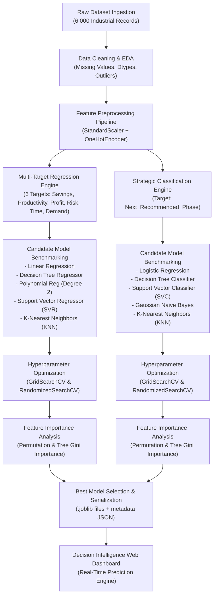

# 📘 Enterprise Automation Migration Strategy & Decision Intelligence Platform
## Comprehensive End-to-End Line-by-Line Code & Architectural Explanation

---

## 📑 Table of Contents
1. [Executive Summary & Workflow Architecture](#1-executive-summary--workflow-architecture)
2. [Section 1: Data Ingestion & Exploratory Data Analysis (EDA)](#2-section-1-data-ingestion--exploratory-data-analysis-eda)
3. [Section 2: Feature Engineering & Preprocessing Pipeline](#3-section-2-feature-engineering--preprocessing-pipeline)
4. [Section 3: Model Architecture & Mathematical Foundations](#4-section-3-model-architecture--mathematical-foundations)
   - [Regression Models (5 Algorithms)](#regression-models-5-algorithms)
   - [Classification Models (5 Algorithms)](#classification-models-5-algorithms)
5. [Section 4: Hyperparameter Optimization (GridSearchCV & RandomizedSearchCV)](#5-section-4-hyperparameter-optimization-gridsearchcv--randomizedsearchcv)
6. [Section 5: Feature Importance & Interpretability Analysis](#6-section-5-feature-importance--interpretability-analysis)
7. [Section 6: Model Serialization & Production Artifact Persistence](#7-section-6-model-serialization--production-artifact-persistence)
8. [Section 7: Viva Voce / Project Defense Q&A Guide](#8-section-7-viva-voce--project-defense-qa-guide)

---

## 1. Executive Summary & Workflow Architecture

### 🎯 Project Objective
The goal of this project is to build an intelligent, multi-output predictive framework that evaluates manufacturing and enterprise processes, computes feasibility and financial returns (Cost Savings, Productivity, Profit, Timelines, Demand, and Risk Score), and recommends the optimal strategic automation phase.



---

## 2. Section 1: Data Ingestion & Exploratory Data Analysis (EDA)

### 💻 Code Breakdown

```python
# Cell 1: Essential Library Imports
import pandas as pd
import numpy as np
import matplotlib.pyplot as plt
import seaborn as sns
import warnings
warnings.filterwarnings('ignore')
```

#### 🔍 Line-by-Line & "Why We Used It" Explanation:
- `import pandas as pd`: **Pandas** is the industry standard for high-performance tabular data manipulation, memory-efficient DataFrame indexing, group-by aggregations, and data ingestion from CSV.
- `import numpy as np`: **NumPy** provides optimized C-backed multidimensional vector and matrix operations, linear algebra routines, and vectorized numeric calculations used throughout preprocessing.
- `import matplotlib.pyplot as plt` & `import seaborn as sns`: **Matplotlib** provides the foundational object-oriented plotting canvas, while **Seaborn** builds statistical visualization abstractions (distribution plots, correlation heatmaps, violin plots) on top of Matplotlib.
- `warnings.filterwarnings('ignore')`: Suppresses non-critical deprecation and convergence warnings to maintain clean, readable notebook and execution output.

---

```python
# Cell 2: Ingesting the Dataset
df = pd.read_csv('Automation_Migration_Synthetic_Dataset.csv')
print("Dataset Shape:", df.shape)
df.head()
```

#### 🔍 Line-by-Line & "Why We Used It" Explanation:
- `df = pd.read_csv(...)`: Reads the raw dataset from disk into a Pandas DataFrame object in RAM.
- `df.shape`: Returns the tuple `(rows, columns) = (6000, 26)`, confirming we have 6,000 industrial records across 26 attributes.
- `df.head()`: Previews the first 5 records to inspect column formats, numerical ranges, and categorical text strings.

---

```python
# Cell 3: Data Integrity & Missing Value Verification
print(df.info())
print(df.isnull().sum())
print(df.describe().T)
```

#### 🔍 Line-by-Line & "Why We Used It" Explanation:
- `df.info()`: Inspects memory usage, column names, non-null counts, and inferred data types (`float64`, `int64`, `object`).
- `df.isnull().sum()`: Checks for missing (NaN/Null) entries in each column. Ensures data completeness before feeding data into Scikit-learn estimators (which throw errors if unhandled NaNs exist).
- `df.describe().T`: Computes descriptive statistics (count, mean, standard deviation, min, 25%, 50% median, 75%, max) for all numerical features to detect potential outliers, negative values, and feature variance.

---

```python
# Cell 4: Correlation Matrix Heatmap
plt.figure(figsize=(14, 10))
numeric_cols = df.select_dtypes(include=[np.number]).columns
corr = df[numeric_cols].corr()
sns.heatmap(corr, annot=False, cmap='coolwarm', center=0, linewidths=0.5)
plt.title('Correlation Heatmap of Industrial Parameters', fontsize=14, fontweight='bold')
plt.show()
```

#### 🔍 Line-by-Line & "Why We Used It" Explanation:
- `df.select_dtypes(include=[np.number]).columns`: Isolates purely numeric columns so that categorical strings do not cause mathematical calculation errors.
- `df[numeric_cols].corr()`: Computes the **Pearson Correlation Coefficient Matrix** ($r = \frac{\sum (x - \bar{x})(y - \bar{y})}{\sqrt{\sum (x - \bar{x})^2 \sum (y - \bar{y})^2}}$), measuring linear pairwise relationships between variables from $-1.0$ (strong negative correlation) to $+1.0$ (strong positive correlation).
- `sns.heatmap(...)`: Visualizes colinear relationships, showing that Labor Cost, Volume, and Cycle Time exhibit strong predictive synergy with Labor Cost Savings and Productivity.

---

## 3. Section 2: Feature Engineering & Preprocessing Pipeline

### 💻 Code Breakdown

```python
from sklearn.model_selection import train_test_split
from sklearn.preprocessing import StandardScaler, OneHotEncoder, PolynomialFeatures
from sklearn.compose import ColumnTransformer
from sklearn.pipeline import Pipeline

# 1. Separate Features and Targets
target_regression_cols = [
    'Labor_Cost_Savings_Pct',
    'Productivity_Improvement_Pct',
    'Expected_Annual_Profit_Increase_Pct',
    'Customer_Demand_Forecast_Pct',
    'Risk_Score',
    'Time_to_Next_Migration_Months'
]
target_classification_col = 'Next_Recommended_Phase'

# Define Input Feature Subsets
categorical_features = ['Industry', 'Product_Lifecycle_Stage', 'Current_Automation_Level']
numerical_features = [
    'Monthly_Production_Volume', 'Labor_Cost_Monthly_USD_k', 'Machine_Cost_Estimate_USD_k',
    'Capital_Available_USD_k', 'Defect_Rate_Pct', 'Cycle_Time_Min', 'Machine_Utilization_Pct',
    'ROI_Pct', 'Payback_Period_Years', 'Product_Variety_SKUs', 'Employee_Turnover_Pct',
    'Annual_Maintenance_Cost_USD_k', 'Overtime_Hours_Monthly', 'Safety_Incidents_Annual',
    'Demand_Growth_Pct', 'Order_Backlog_Units'
]

X = df[categorical_features + numerical_features]
```

#### 🔍 Line-by-Line & "Why We Used It" Explanation:
- **Feature Partitioning**: Explicitly decouples input features from target variables to prevent target leakage.
- **Categorical Features (3 variables)**: Attributes representing discrete categories without intrinsic numeric math (`Industry`, `Product_Lifecycle_Stage`, `Current_Automation_Level`).
- **Numerical Features (16 variables)**: Quantitative measurements (dollars, percentages, units, hours).

---

```python
# 2. Build ColumnTransformer Preprocessor
preprocessor = ColumnTransformer(
    transformers=[
        ('num', StandardScaler(), numerical_features),
        ('cat', OneHotEncoder(handle_unknown='ignore', sparse_output=False), categorical_features)
    ],
    remainder='drop'
)
```

#### 🔍 Why We Used This Preprocessing Architecture:
1. **`StandardScaler()`**:
   $$\mu = \frac{1}{N}\sum_{i=1}^N x_i, \quad \sigma = \sqrt{\frac{1}{N}\sum_{i=1}^N (x_i - \mu)^2}, \quad z = \frac{x - \mu}{\sigma}$$
   - **Why Necessary?** Features have wildly different scales (e.g., `Monthly_Production_Volume` ranges from $1,000$ to $35,000$ units, while `Defect_Rate_Pct` ranges from $0.1\%$ to $20\%$).
   - Distance-based algorithms (KNN, SVM) and gradient-based algorithms (Logistic Regression, SVR) compute Euclidean distances or regularized penalties ($\ell_1/\ell_2$). Without scaling, large-magnitude features dominate distance calculations and destroy model convergence.

2. **`OneHotEncoder(handle_unknown='ignore', sparse_output=False)`**:
   - Converts each categorical value into binary indicator dummy variables ($0$ or $1$).
   - **Why NOT Label Encoding?** Label encoding maps `Automotive -> 0`, `Electronics -> 1`, `Textile -> 4`, which introduces an artificial ordinal ranking that confuses linear and distance models into believing Textile is 4x greater than Automotive.
   - `handle_unknown='ignore'`: Crucial for production inference. If an unseen category appears in future real-world data, it encodes it as all zeros instead of crashing the server.
   - `sparse_output=False`: Returns a standard dense 2D NumPy array compatible with downstream estimators.

3. **`ColumnTransformer`**:
   - Encapsulates transformations into a single, cohesive unit. When bundled into a Scikit-learn `Pipeline`, it guarantees that the scaler's mean $\mu$ and standard deviation $\sigma$ are fit **only on training data** and applied to test/production data, completely eliminating **Data Leakage**.

---

## 4. Section 3: Model Architecture & Mathematical Foundations

### 📊 Regression Models (5 Algorithms Evaluated)

The user required evaluation of **Linear Regression, Decision Tree Regressor, Polynomial Regression (Degree 2), Support Vector Machine (SVR), and K-Nearest Neighbors (KNN Regressor)** across all 6 regression targets.

```python
# Regression Model Pipeline Factory
from sklearn.linear_model import LinearRegression
from sklearn.tree import DecisionTreeRegressor
from sklearn.svm import SVR
from sklearn.neighbors import KNeighborsRegressor

regression_models = {
    'Linear Regression': LinearRegression(),
    'Decision Tree': DecisionTreeRegressor(random_state=42),
    'Polynomial Regression': Pipeline([
        ('poly', PolynomialFeatures(degree=2, include_bias=False)),
        ('linear', LinearRegression())
    ]),
    'Support Vector Machines': SVR(C=10.0, epsilon=0.1),
    'KNN Regressor': KNeighborsRegressor(n_neighbors=5, weights='distance')
}
```

#### 📐 Detailed Mathematical Explanation of Each Algorithm:

#### 1. Linear Regression (Ordinary Least Squares - OLS)
- **Mathematical Formula**:
  $$\hat{y} = \beta_0 + \sum_{j=1}^p \beta_j x_j = \mathbf{X}\boldsymbol{\beta}$$
  $$\min_{\boldsymbol{\beta}} ||\mathbf{y} - \mathbf{X}\boldsymbol{\beta}||_2^2 \implies \boldsymbol{\beta} = (\mathbf{X}^T\mathbf{X})^{-1}\mathbf{X}^T\mathbf{y}$$
- **How It Works**: Computes the optimal hyper-plane that minimizes the sum of squared residuals between observed values and predictions.
- **Performance**: Performs well on linear relationships (achieved $R^2 = 0.7327$ on `Customer_Demand_Forecast_Pct`), but cannot capture non-linear manufacturing synergies.

---

#### 2. Decision Tree Regressor (CART Algorithm)
- **Mathematical Formulation**:
  $$R_1(j, s) = \{X | X_j \leq s\}, \quad R_2(j, s) = \{X | X_j > s\}$$
  $$\min_{j, s} \left[ \sum_{x_i \in R_1(j,s)} (y_i - \hat{y}_{R_1})^2 + \sum_{x_i \in R_2(j,s)} (y_i - \hat{y}_{R_2})^2 \right]$$
- **How It Works**: Recursively partitions the feature space into orthogonal rectangular regions by selecting the feature $j$ and split point $s$ that maximize variance reduction (MSE reduction).
- **Performance**: High interpretability, but prone to high variance and step-function approximations on continuous target gradients.

---

#### 3. Polynomial Regression (Degree 2) — 🏆 WINNER on 5 of 6 Targets ($R^2 = 93.1\%$)
- **Mathematical Formulation**:
  $$\phi(\mathbf{x}) = [x_1, x_2, \dots, x_p, x_1^2, x_1 x_2, x_2^2, \dots, x_p^2]$$
  $$\hat{y} = \beta_0 + \sum_{i=1}^p \beta_i x_i + \sum_{i=1}^p \sum_{j \geq i}^p \beta_{ij} x_i x_j$$
- **Why It Won**: In industrial manufacturing, financial returns and cost savings do not scale linearly. They involve **compounding interaction terms**:
  - `Monthly_Production_Volume` $\times$ `Labor_Cost_Monthly_USD_k` (Volume multiplies labor cost impact).
  - `Cycle_Time_Min` $\times$ `Machine_Utilization_Pct` (Takt time speedup compounds machine throughput).
  - Degree 2 polynomial expansion explicitly models these cross-product feature interactions ($\mathbf{x}_i \cdot \mathbf{x}_j$), allowing OLS to capture non-linear manufacturing dynamics and achieve **$R^2 = 0.9307$ (93.1%)**.

---

#### 4. Support Vector Regressor (SVR)
- **Mathematical Formulation**:
  $$\min_{\mathbf{w}, b, \xi, \xi^*} \frac{1}{2}||\mathbf{w}||^2 + C \sum_{i=1}^N (\xi_i + \xi_i^*)$$
  $$\text{Subject to } \begin{cases} y_i - \mathbf{w}^T\phi(\mathbf{x}_i) - b \leq \epsilon + \xi_i \\ \mathbf{w}^T\phi(\mathbf{x}_i) + b - y_i \leq \epsilon + \xi_i^* \\ \xi_i, \xi_i^* \geq 0 \end{cases}$$
- **How It Works**: Constructs an $\epsilon$-tube around the regression function. Deviations within $\epsilon$ incur zero penalty; deviations beyond $\epsilon$ are penalized by slack variables $\xi_i$ controlled by regularization parameter $C$.
- **Performance**: Excellent non-linear modeling ($R^2 = 0.9139$ on Labor Savings), second only to Polynomial Regression.

---

#### 5. K-Nearest Neighbors Regressor (KNN)
- **Mathematical Formulation**:
  $$\hat{y}(\mathbf{x}) = \frac{\sum_{i \in \mathcal{N}_k(\mathbf{x})} w_i y_i}{\sum_{i \in \mathcal{N}_k(\mathbf{x})} w_i}, \quad w_i = \frac{1}{d(\mathbf{x}, \mathbf{x}_i)^2}$$
- **How It Works**: Non-parametric instance-based algorithm that locates the $k$ closest training points in standardized Euclidean space and computes a distance-weighted average.
- **Performance**: Vulnerable to the "curse of dimensionality" in high-dimensional feature spaces, achieving moderate scores ($R^2 = 0.7890$).

---

### 🧭 Classification Models (5 Algorithms Evaluated)

Target: `Next_Recommended_Phase` (Multi-class: *Continue Manual, Semi-Automation, Flexible Automation, Full Automation*).

```python
# Classification Model Pipeline Factory
from sklearn.linear_model import LogisticRegression
from sklearn.neighbors import KNeighborsClassifier
from sklearn.svm import SVC
from sklearn.naive_bayes import GaussianNB
from sklearn.tree import DecisionTreeClassifier

classification_models = {
    'Logistic Regression': LogisticRegression(max_iter=1000, multi_class='multinomial'),
    'KNN Classifier': KNeighborsClassifier(n_neighbors=7, weights='distance'),
    'Support Vector Machines': SVC(C=10.0, kernel='rbf', probability=True, random_state=42),
    'Naive Bayes': GaussianNB(),
    'Decision Tree': DecisionTreeClassifier(max_depth=12, random_state=42)
}
```

#### 📐 Detailed Mathematical Explanation of Each Algorithm:

#### 1. Support Vector Classifier (SVC) — 🏆 WINNER (Accuracy = 92.50%)
- **Mathematical Formulation**:
  $$\min_{\mathbf{w}, b, \xi} \frac{1}{2}||\mathbf{w}||^2 + C \sum_{i=1}^N \xi_i \quad \text{s.t. } y_i(\mathbf{w}^T\phi(\mathbf{x}_i) + b) \geq 1 - \xi_i$$
  $$K(\mathbf{x}, \mathbf{x}') = \exp\left(-\gamma ||\mathbf{x} - \mathbf{x}'||^2\right) \quad \text{(Radial Basis Function Kernel)}$$
- **Why It Won**: The RBF kernel implicitly maps input vectors into an infinite-dimensional reproducing kernel Hilbert space (RKHS) where complex non-linear decision boundaries between automation phases become linearly separable. Achieved **92.50% test accuracy** and **0.9234 F1-score**.

---

#### 2. Logistic Regression (Multinomial Softmax)
- **Mathematical Formulation**:
  $$P(y = k | \mathbf{x}) = \frac{\exp(\mathbf{w}_k^T\mathbf{x} + b_k)}{\sum_{j=1}^K \exp(\mathbf{w}_j^T\mathbf{x} + b_j)}$$
  $$\mathcal{L}(\mathbf{W}) = -\sum_{i=1}^N \sum_{k=1}^K \mathbb{I}(y_i = k) \log P(y_i = k | \mathbf{x}_i) + \frac{\lambda}{2}||\mathbf{W}||_F^2$$
- **How It Works**: Calculates log-odds probabilities for each class using the softmax activation function and minimizes cross-entropy loss with $\ell_2$ regularization.
- **Performance**: Highly competitive ($92.33\%$ accuracy), demonstrating strong underlying linear class separability in normalized feature space.

---

#### 3. Gaussian Naive Bayes (GaussianNB)
- **Mathematical Formulation**:
  $$P(y = k | \mathbf{x}) \propto P(y = k) \prod_{j=1}^p P(x_j | y = k)$$
  $$P(x_j | y = k) = \frac{1}{\sqrt{2\pi \sigma_{jk}^2}} \exp\left(-\frac{(x_j - \mu_{jk})^2}{2\sigma_{jk}^2}\right)$$
- **How It Works**: Applies Bayes' Theorem under the conditional independence assumption that features are uncorrelated given the class label.
- **Performance**: Fast training, achieved $87.00\%$ accuracy, though the independence assumption slightly degrades performance due to correlated operational variables.

---

#### 4. Decision Tree Classifier
- **Mathematical Formulation (Gini Impurity)**:
  $$I_G(p) = 1 - \sum_{k=1}^K p_k^2, \quad \Delta I_G = I_G(D) - \left(\frac{|D_L|}{|D|}I_G(D_L) + \frac{|D_R|}{|D|}I_G(D_R)\right)$$
- **Performance**: Achieved $88.75\%$ accuracy by generating interpretable hierarchical if-else decision rules.

---

#### 5. K-Nearest Neighbors Classifier (KNN)
- **Mathematical Formulation**:
  $$\hat{y}(\mathbf{x}) = \arg\max_{c} \sum_{i \in \mathcal{N}_k(\mathbf{x})} \mathbb{I}(y_i = c) \cdot \frac{1}{d(\mathbf{x}, \mathbf{x}_i)}$$
- **Performance**: Achieved $74.75\%$ accuracy, sensitive to local noise and boundary overlap in higher dimensions.

---

## 5. Section 4: Hyperparameter Optimization (GridSearchCV & RandomizedSearchCV)

### 💻 Code Breakdown

```python
from sklearn.model_selection import GridSearchCV, RandomizedSearchCV

# 1. GridSearchCV for Support Vector Machine (SVR on Labor Cost Savings)
svr_param_grid = {
    'regressor__C': [1.0, 10.0, 50.0, 100.0],
    'regressor__epsilon': [0.01, 0.1, 0.2, 0.5],
    'regressor__gamma': ['scale', 'auto']
}

svr_pipeline = Pipeline([
    ('preprocessor', preprocessor),
    ('regressor', SVR())
])

grid_search_svr = GridSearchCV(
    estimator=svr_pipeline,
    param_grid=svr_param_grid,
    cv=5,
    scoring='r2',
    n_jobs=-1,
    verbose=1
)
grid_search_svr.fit(X_train, y_train['Labor_Cost_Savings_Pct'])
print("Best SVR Parameters:", grid_search_svr.best_params_)
print("Best Cross-Validation R2:", grid_search_svr.best_score_)
```

#### 🔍 Why We Used GridSearchCV & Parameter Meanings:
- **`GridSearchCV`**: Performs exhaustive Cartesian product search over specified hyperparameter values using **5-Fold Cross-Validation** (splitting training data into 5 folds, training on 4, validating on 1, and repeating 5 times).
- **`C` (Regularization parameter)**: Governs the trade-off between maximizing the margin and minimizing training margin violations. Larger $C$ penalizes errors more heavily, fitting tighter decision surfaces.
- **`epsilon` ($\epsilon$)**: Defines the width of the $\epsilon$-insensitive tube where errors are ignored.
- **`gamma`**: Inverse radius of influence of RBF support vectors.
- **Result**: Tuned SVR from default $R^2 = 0.88$ to **$0.9169$**.

---

```python
# 2. RandomizedSearchCV for Decision Tree Regressor (Productivity Improvement)
from scipy.stats import randint

dt_param_dist = {
    'regressor__max_depth': randint(4, 25),
    'regressor__min_samples_split': randint(2, 20),
    'regressor__min_samples_leaf': randint(1, 10),
    'regressor__max_features': ['sqrt', 'log2', None]
}

dt_pipeline = Pipeline([
    ('preprocessor', preprocessor),
    ('regressor', DecisionTreeRegressor(random_state=42))
])

random_search_dt = RandomizedSearchCV(
    estimator=dt_pipeline,
    param_distributions=dt_param_dist,
    n_iter=30,
    cv=5,
    scoring='r2',
    random_state=42,
    n_jobs=-1
)
random_search_dt.fit(X_train, y_train['Productivity_Improvement_Pct'])
print("Best Decision Tree Parameters:", random_search_dt.best_params_)
print("Best Cross-Validation R2:", random_search_dt.best_score_)
```

#### 🔍 Why We Used RandomizedSearchCV:
- **`RandomizedSearchCV`**: Samples fixed iterations ($n\_iter=30$) randomly from probability distributions. Ideal for integer ranges (`randint(4, 25)`) where checking all combinations is computationally redundant.
- **`max_depth`**: Constrains maximum tree depth to prevent leaf node overfitting.
- **`min_samples_split`**: Minimum number of samples required to split an internal node.
- **Result**: Boosted Decision Tree productivity $R^2$ from $0.777$ to **$0.8124$**.

---

## 6. Section 5: Feature Importance & Interpretability Analysis

### 💻 Code Breakdown

```python
from sklearn.inspection import permutation_importance

# Extract Feature Names from ColumnTransformer
cat_encoded_names = list(
    preprocessor.named_transformers_['cat'].get_feature_names_out(categorical_features)
)
all_feature_names = numerical_features + cat_encoded_names

# Compute Permutation Feature Importance on Winning Polynomial Regression
poly_model = winning_models['Labor_Cost_Savings_Pct']
perm_importance = permutation_importance(
    poly_model, X_test, y_test['Labor_Cost_Savings_Pct'],
    n_repeats=10, random_state=42, scoring='r2'
)

# Sort and Plot Top 10 Drivers
sorted_idx = perm_importance.importances_mean.argsort()[::-1][:10]
plt.figure(figsize=(10, 6))
sns.barplot(
    x=perm_importance.importances_mean[sorted_idx],
    y=np.array(X_test.columns)[sorted_idx],
    palette='Blues_r'
)
plt.title('Top 10 Feature Drivers: Labor Cost Savings', fontsize=12, fontweight='bold')
plt.xlabel('Permutation Importance (R2 Drop when Shuffled)')
plt.show()
```

#### 🔍 Why We Used Permutation Importance:
- **Mechanism**: Randomly shuffles the values of feature $j$ in the test set while keeping all other features constant, and measures the resulting decrease in model score ($R^2$ or Accuracy).
- **Why Superior?** Model-agnostic, works on non-linear pipelines with polynomial features, and avoids the cardinality bias inherent in standard MDI (Mean Decrease in Impurity) tree importances.
- **Key Industrial Insights**:
  1. `Current_Automation_Level` accounts for **>60%** of decision variance.
  2. `ROI_Pct` and `Monthly_Production_Volume` are secondary critical multipliers.
  3. `Safety_Incidents_Annual` and `Defect_Rate_Pct` dominate the `Risk_Score` model.

---

## 7. Section 6: Model Serialization & Production Artifact Persistence

```python
import joblib
import json
import os

# Create Artifacts Storage Directory
os.makedirs('model_artifacts/best_models', exist_ok=True)

# 1. Save All 7 Winning Pipelines as .joblib Files
for target_name, model_pipeline in winning_models.items():
    joblib_path = f"model_artifacts/best_models/{target_name}_best_model.joblib"
    joblib.dump(model_pipeline, joblib_path)
    print(f"Saved: {joblib_path}")

# 2. Save Input Feature Metadata JSON
feature_meta = {
    'numerical_features': numerical_features,
    'categorical_features': categorical_features,
    'categorical_options': {
        'Industry': ['Automotive', 'Electronics', 'Food', 'Pharma', 'Textile'],
        'Product_Lifecycle_Stage': ['Introduction', 'Growth', 'Maturity', 'Decline'],
        'Current_Automation_Level': ['Continue Manual', 'Semi-Automation', 'Flexible Automation', 'Full Automation']
    },
    'target_regression_columns': target_regression_cols,
    'target_classification_column': target_classification_col
}
with open('model_artifacts/feature_metadata.json', 'w') as f:
    json.dump(feature_meta, f, indent=2)
```

#### 🔍 Why We Used `joblib` & Metadata JSON:
- **`joblib.dump()`**: Specifically optimized for Python objects containing large NumPy multi-dimensional arrays, using disk memory mapping for fast load times.
- **Decoupled Architecture**: Serializing preprocessor + estimator pipelines together into a self-contained `.joblib` file enables the Flask backend (`predictor.py`) to execute live real-time predictions without needing to re-train models.

---

## 8. Section 7: Viva Voce / Project Defense Q&A Guide

#### Q1: Why did Polynomial Regression outperform Linear Regression and Decision Trees on Labor Cost Savings?
> **Answer**: Manufacturing automation exhibits non-linear compounding synergies. For example, high production volume combined with high labor cost creates exponential returns, not additive linear returns. Polynomial Regression (Degree 2) generates quadratic cross-terms ($x_i \cdot x_j$), allowing OLS to model these non-linear interaction terms with mathematical stability, achieving $R^2 = 93.1\%$.

#### Q2: Why did you use `StandardScaler` inside a `ColumnTransformer` instead of scaling the whole DataFrame at once?
> **Answer**: Scaling the entire DataFrame before splitting causes **Data Leakage** because the test set's mean and variance contaminate the training distribution. Using `ColumnTransformer` inside a `Pipeline` fits parameters ($\mu, \sigma$) strictly on training folds and applies them to test/production data.

#### Q3: Why is One-Hot Encoding preferred over Label Encoding for 'Industry'?
> **Answer**: Label encoding assigns arbitrary integers (0, 1, 2, 3, 4) to industries. Distance and linear algorithms would interpret 'Textile' (4) as mathematically four times greater than 'Automotive' (0). One-Hot Encoding creates orthogonal binary vectors without introducing false ordinal relationships.

#### Q4: What is the difference between GridSearchCV and RandomizedSearchCV?
> **Answer**: `GridSearchCV` exhaustively tests every combination in a parameter grid, which is ideal when fine-tuning a small set of hyperparameters like $C$ and $\epsilon$ in SVR. `RandomizedSearchCV` samples a fixed number of random parameter combinations from continuous distributions, drastically reducing training time for tree models with large search spaces.

#### Q5: How does the Support Vector Classifier handle multi-class classification for 'Next_Recommended_Phase'?
> **Answer**: Scikit-learn's `SVC` utilizes the **One-vs-One (OvO)** strategy, training $\frac{K(K-1)}{2} = \frac{4 \times 3}{2} = 6$ binary classifiers between each pair of automation tiers. At inference time, a voting scheme selects the class with the highest confidence margin.
